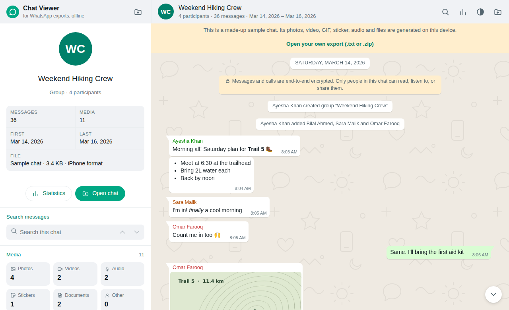
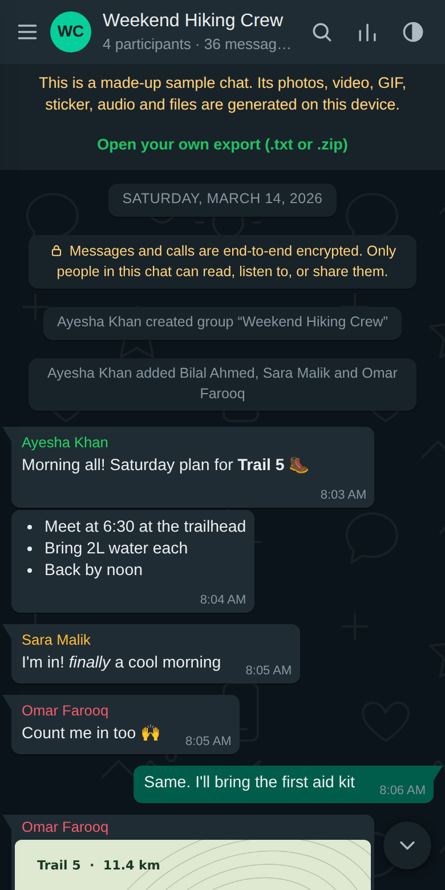
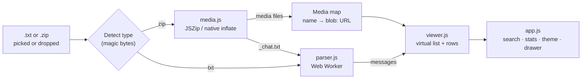

# WhatsApp Chat Viewer

[](https://github.com/chuzair598337/whatsapp-chat-viewer/actions/workflows/deploy-pages.yml)

**Live app:** https://chuzair598337.github.io/whatsapp-chat-viewer/

Read your exported WhatsApp chats in a familiar, WhatsApp-style interface, with photos, videos, voice notes, documents, search and statistics. The chat is processed **entirely in your browser**: nothing is uploaded, and the page makes no network requests once it has loaded. The one exception is **Online link previews** in Settings, which is off unless you turn it on: then supported links (YouTube, Instagram, TikTok, Spotify, Google Docs and a few more) can play inside the chat and show their titles, loaded only from the site the link points to.

| Desktop (light) | Phone (dark) |
|---|---|
|  |  |

*The screenshots show the built-in sample chat. Its people and media are made up.*

## Highlights

- Opens a plain `.txt` export or a full `.zip` export with media, or several chats at once with a chat list to switch between them.
- Reads iPhone and Android formats, 12-hour and 24-hour times, and day/month or month/day dates, detected automatically.
- Shows photos (with a zoomable viewer), stickers, GIFs, videos (including portrait), voice notes with waveforms (and optional autoplay of voice notes sent in a row), audio files, PDFs with page previews, documents, contact cards and link cards.
- Marks messages WhatsApp leaves out of exports, such as events, instead of hiding them.
- Search with highlighting, match navigation, Match case, Whole word and Regex options, and your recent searches (`/` to start), date-range and sender filters, jump-to-date and jump-to-bottom.
- Star messages to collect them in a chat-style side panel while you read. Stars aren't saved, so you can export them to a file and import them the next time you open the chat.
- Group chats show coloured names and initials avatars, and reaction lines become reaction pills.
- A statistics window with message counts, top senders and activity charts.
- A Settings screen like WhatsApp's for who you are, light, dark and system themes, the language, the background pattern, autoplay of voice messages, the date format and nicknames for anyone in the chat, and a responsive layout for desktop and phone.
- English, Urdu and Arabic interface, with a right-to-left layout for Urdu and Arabic. Urdu text in the chat is drawn in a Nastaliq font and Arabic in Noto Naskh Arabic, in every interface language, even when a message mixes them with English. Chat text is never translated, and sent messages stay on the right.
- A WhatsApp-style message menu (long-press, right-click or the ⌄ button): star, copy, download, share and more. In Media, links and docs, sorting, an Autoplay button for audio and an options menu on every item with **Go to message**. A side panel you can hide on large screens.
- A start screen for picking a chat, plus a sample chat with a guided tour of every feature. **Help and guided tour** in the ⋮ menu brings the tour back.
- Keyboard shortcuts for every major action, such as `Ctrl+O` / `⌘O` to open a chat, `Ctrl+F` / `⌘F` to search, `Ctrl+,` / `⌘,` for Settings and `J` / `K` to move between messages. Press `?` for the full list, also in Settings and the ⋮ menu.
- Handles chats of 50,000+ messages smoothly.

The full feature list is in **[docs/features.md](docs/features.md)**, and release notes are in **[CHANGELOG.md](CHANGELOG.md)**.

## Architecture



- **Static site:** plain HTML, CSS and JavaScript with no build step and no server code.
- **Six dependencies, all vendored in `js/vendor/`:** JSZip; Simple Icons brand logos for link cards; pdf.js for PDF previews, only loaded when a chat has a PDF; the lottie-web light build for iPhone animated stickers, only loaded when a chat has one; libheif for HEIC photos outside Safari, only loaded when one needs decoding; and Notyf for notifications.
- **Parsing and unzipping:** run in Web Workers created from inline Blob URLs, so large chats don't freeze the page.
- **Media:** stays in memory as `blob:` URLs, which are revoked when another chat is opened.
- **Rendering:** only the rows on screen exist in the DOM. A Fenwick tree tracks row heights for fast scrolling.

```
whatsapp-chat-viewer/
├── .github/workflows/deploy-pages.yml   # deploys main to GitHub Pages
├── docs/
│   ├── features.md                       # what the app does today (kept in step with the code)
│   ├── todo.md                           # requested work not built yet
│   ├── deferred.md                       # out of scope, and why
│   └── images/                           # README screenshots
├── index.html                            # page markup
├── fonts/                                # Noto Nastaliq Urdu and Noto Naskh Arabic (OFL)
├── tests/parser.test.js                  # parser tests
├── tests/release-notes.test.js           # checks the What's new notes match the version (run by the deploy)
├── css/styles.css                        # styles and light/dark theme tokens
├── css/settings.css                      # Settings screen
├── js/
│   ├── vendor/jszip.min.js               # JSZip 3.10.1 (MIT)
│   ├── vendor/pdfjs/                     # pdf.js 3.11.174 (Apache-2.0), loaded on demand
│   ├── vendor/lottie/                    # lottie-web 5.13.0 light build (MIT), loaded on demand
│   ├── vendor/libheif/                   # libheif-js 1.23.5 HEIC decoder (LGPL-3.0), loaded on demand
│   ├── vendor/notyf/                     # Notyf 3.10.0 notifications (MIT)
│   ├── vendor/brand-icons/               # Simple Icons 16.34.0 logo subset for link cards (CC0)
│   ├── i18n/                             # i18n.js (t() helper), en.js, ur.js and ar.js dictionaries
│   ├── parser.js                         # chat parser and worker setup
│   ├── media.js                          # ZIP reading, media map, audio controller
│   ├── text-truncator.js                 # Read more / Show less for long messages
│   ├── viewer.js                         # formatting, virtual list, media players
│   ├── demo-data.js                      # made-up sample chat and its generated media
│   ├── app.js                            # file loading, search, stats, theme, boot
│   ├── release-notes.js                  # What's new notes per version, in English, Urdu and Arabic
│   ├── components/                       # toast.js, media-gallery.js, gallery-menu.js, viewer-menu.js, autoplay.js, link-cards.js, message-menu.js, select-messages.js, settings.js, nicknames.js, search-history.js, shortcuts-list.js, shortcuts.js, whats-new.js
│   └── tour-controller.js                # welcome dialog and guided tour
├── .claude/skills/                       # agent guides: parser, virtual scroll, media, release
├── CHANGELOG.md                          # release notes
├── CLAUDE.md                             # short pointer for coding agents
├── PROJECT_RULES.md                      # rules for every change (privacy, both export types, performance, a11y)
├── .gitignore
└── README.md
```

## Usage

### 1. Export a chat from WhatsApp

| | iPhone | Android |
|---|---|---|
| Open | the chat, then tap the contact or group name | the chat, then tap **⋮ › More** |
| Choose | **Export Chat** | **Export chat** |
| Pick | **Attach Media** (photos, videos, voice notes) or **Without Media** (text only) | **Include media** or **Without media** |
| Save | the `.zip` to Files, or send it to your computer | the `.zip` or `.txt` to your device or computer |

### 2. Open it in the viewer

1. Go to the [live app](https://chuzair598337.github.io/whatsapp-chat-viewer/).
2. On the start screen, drag the `.zip` or `.txt` file onto the page or click **Browse files**. You don't need to unzip it first. To look around first, choose **Try the sample chat**.
3. Pick which participant is you, so your messages show on the right.

To use the viewer with no internet connection, download the repository and open `index.html` straight from disk.

### What WhatsApp exports leave out

The viewer can only show what's in the export file. WhatsApp leaves out:
- **Reactions.** If your export does contain `reacted … to "…"` lines, the viewer shows them as reaction pills.
- **Replies:** which earlier message a reply was answering.
- **Events:** the export has an empty line in their place, and the viewer marks it.
- **Messages that never loaded** on the exporting phone: the export says "Waiting for this message" instead of the content, and the viewer shows a "Message wasn't loaded" card.
- **View-once media.**
- **Media** you chose not to include when exporting.

## Local development

You don't need to install anything. Clone the repository and either open `index.html` directly or serve the folder:

```bash
git clone https://github.com/chuzair598337/whatsapp-chat-viewer.git
cd whatsapp-chat-viewer
git checkout development

python3 -m http.server 8000      # or: npx serve .
# then open http://localhost:8000
```

Run the parser tests with `node tests/parser.test.js` and the keyboard shortcut tests with `node tests/shortcuts.test.js`, and the What's new notes with `node tests/release-notes.test.js` (Node 18 or later, nothing to install).

Notes:
- The scripts are classic `<script>` files that share globals, loaded in order: `jszip` → `i18n/i18n` → `i18n/en` → `i18n/ur` → `i18n/ar` → `vendor/notyf` → `components/toast` → `parser` → `media` → `text-truncator` → `vendor/brand-icons` → `viewer` → `components/link-cards` → `demo-data` → `app` → `components/media-gallery` → `components/message-menu` → `components/gallery-menu` → `components/viewer-menu` → `components/select-messages` → `components/autoplay` → `components/settings` → `components/nicknames` → `components/search-history` → `components/shortcuts-list` → `components/shortcuts` → `tour-controller` → `release-notes` → `components/whats-new`. Keep that order when adding files.
- Keep the app offline. Don't add CDN links, web fonts, analytics or anything that fetches at runtime. Vendor any library into `js/vendor/`. The only exception is the opt-in Online link previews in `js/components/link-cards.js` (see PROJECT_RULES.md, section 1).
- Test chats are ignored by `.gitignore` (`*.zip`, `*.txt`). Never commit a real chat export.

## Branching and contributions

Read [PROJECT_RULES.md](PROJECT_RULES.md) first. What the app does is in [docs/features.md](docs/features.md), requested work that isn't built yet is in [docs/todo.md](docs/todo.md), and ideas that were ruled out are in [docs/deferred.md](docs/deferred.md).

| Branch | Purpose |
|---|---|
| `main` | Production. Every push deploys to GitHub Pages. |
| `development` | Default branch for day-to-day work, where features and fixes are integrated. |

Workflow:

1. Branch from `development`, for example `feature/voice-speed` or `fix/android-dates`.
2. Open a pull request into `development`. Check the viewer by hand with a `.txt` and a `.zip` export, in light and dark mode, and at phone width.
3. When `development` is ready to release, follow `.claude/skills/release-skill`: date the CHANGELOG's Unreleased section, bump `APP_VERSION`, and add the version's **What's new** notes to `js/release-notes.js` in English, Urdu and Arabic. Then open a pull request from **`development` → `main`**.
4. Merging into `main` runs the **Deploy to GitHub Pages** workflow, and the live site updates a minute or two later. The workflow first runs `node tests/release-notes.test.js` and stops if the notes don't match the version. Each user sees the new version's notes once, the next time they open the app.

## License

The viewer's code is provided as-is by its author. JSZip is used under the MIT license (see the header of `js/vendor/jszip.min.js`), pdf.js under the Apache License 2.0 (`js/vendor/pdfjs/LICENSE`), lottie-web under the MIT license (`js/vendor/lottie/LICENSE.md`), Notyf under the MIT license (`js/vendor/notyf/LICENSE.md`), the Simple Icons brand logos under CC0 1.0 (`js/vendor/brand-icons/LICENSE.md`; the logos remain trademarks of their owners and only label links to their sites), libheif (the HEIC decoder, from libheif-js) under the GNU LGPL 3.0 (`js/vendor/libheif/LICENSE`), and the Noto Nastaliq Urdu and Noto Naskh Arabic fonts under the SIL Open Font License 1.1 (`fonts/OFL-noto-nastaliq-urdu.txt`, `fonts/OFL-noto-naskh-arabic.txt`).
